# invariants

**Write down what must never happen. Prove a guard stops it, and prove nothing goes around it.**

[](.github/workflows/ci.yml)
[](pyproject.toml)
[](LICENSE)
[](CHANGELOG.md)

`invariants` turns the properties your system must never break ("a refund never exceeds the charge",
"a model's cause never contradicts the kernel log") into reviewed rules in one YAML file. Explicit
decorators enforce them at run time. A CLI proves every path to the protected effect passes the
guard, and a pytest plugin proves each guard is load-bearing by switching it off and watching a
test fail. It is built for code that agents and LLMs help write and run.

## Start in 10 minutes: lock the rules you already have

You don't need to write a rule to start. Your pydantic `Field(le=10_000)`s, `Literal`s and SQL
`CHECK` constraints are already rules. `inv init` finds them and pins them, and from then on no
change can loosen one without a person accepting it.

```bash
pip install invariants-first        # not on PyPI yet: pip install -e path/to/invariants-py
inv init                            # drafts invariants.yaml from your code and locks it; commit both files
```

An agent raises a limit to make its test pass, then re-pins the lock itself to hide the change.
CI compares against `main` and still catches it. This is real output:

```text
$ inv check --base main
inv check: invariants.yaml
  ok    rules: 0 rule(s), 2 contract(s) load
  ok    lock: invariants.lock matches
  FAIL  since main
        1 change(s) since main weaken a rule:
          schema billing.models.RefundRequest: pydantic.properties.amount.maximum: 10000 -> 100000  WEAKENED (maximum raised: larger values pass; used by contract refund_request schema)
        a person must accept these: re-run with --allow-weakening or INV_ALLOW_WEAKENING=1, set by a reviewer (for example from a pull-request label), never by the change's author or agent
fail
```

To make the check hard to skip, copy one snippet per layer: a pre-commit hook (`inv check --relock`),
a GitHub Action (`inv check --base`, which a reviewer's label can override) and Claude Code hooks.
The `inv hook pretool` hook stops the agent from accepting a weakening, and `inv hook stop` keeps it
from finishing while the check fails. [docs/start.md](docs/start.md) has all three snippets, plus the
next step: a two-line `guard` rule on the function that moves the money.

## Before and after

An agent adds a helper. It looks fine, and the tests it wrote pass:

```python
def refund_order(charge_id: str, total: int, refunded: int) -> None:   # an agent's new helper
    refund(charge_id, charged=total, refunded=refunded, amount=total)   # forgets the earlier refund
```

One rule, written once, next to the code it protects:

```yaml
  - id: PAY-1
    status: enforce
    statement: a refund is positive and never exceeds what is left of the charge
    subject: {target: "py:payments.refund"}
    bad:
      - {when: 'args.amount <= 0', message: refund must be positive}
      - {when: 'args.refunded + args.amount > args.charged', message: refund exceeds what is left of the charge}
    enforcers: [{point: decorator, timing: pre_effect, mode: enforce, on_violation: reject}]
```

The money never leaves:

```text
invariants.errors.Rejected: PAY-1 violation: refund exceeds what is left of the charge
```

And CI proves the guard, not luck, is what stopped it:

```text
$ pytest --inv-rules invariants.yaml --inv-ablate -q
..                                                                       [100%]
----------------------------- invariants ablation ------------------------------
  PAY-1: load-bearing
      caught         test_payments.py::test_over_refund_is_rejected
2 passed in 0.06s
```

## Why invariants-first

Tests check the cases someone thought of. Types check shapes. The properties that matter most
usually live in scattered `if`s that a new caller, human or agent, can simply skip. This library
keeps each property as one reviewed record with an owner and a status, and then checks three
things nothing else checks together: that the guard runs, that it is the reason the bad case
fails, and that no code path goes around it.

| | invariants-first | plain `assert`/`if` | pydantic | icontract / deal | OPA / Cedar | hypothesis |
|---|---|---|---|---|---|---|
| Checks at run time | yes, at the call | yes | at the data boundary | yes (pre, post, class invariants) | yes, when the app asks | no (test time) |
| Rules reviewed apart from code, with owner and status | yes | no | no | no (in code) | **yes, and at scale** | no |
| Ablation-proven falsifier (`--inv-ablate`) | yes | no | no | no | policy unit tests, not proof the app calls them | no |
| Mediation scan: no path around the guard (`inv scan`) | yes | no | no | no | no | no |
| Weakening-gated lockfile (`inv lock`) | yes | no | no | no | git diff only | no |
| Model-call parse, retry, abstain, and checked edges | yes | no | **parsing yes**, the loop no | no | no | no |
| Standing report (held, monitored, candidate) | yes | no | no | no | no (decision logs record calls) | no |
| Finds inputs nobody thought of | no | no | no | deal: cases generated from contracts | Cedar: formal policy analysis | **yes** |
| Maturity and ecosystem | alpha, 0.1 | built in | **excellent** | mature | **production-grade** | **excellent** |

These tools fit together: invariants uses pydantic models as reply schemas, and a hypothesis test
makes a fine falsifier. Choose OPA or Cedar for authorization across services, icontract or deal for
rich class contracts, and invariants for evidence that a property holds on every path in one codebase.

## Is this for me?

We measured it, on a small scale: 24 seeded changes (16 defects, 8 benign) against the two example
apps, compared with the same properties written as plain `if` checks plus tests. One author wrote
both the changes and the rules, so read the method and the verdict in
[docs/evaluation.md](docs/evaluation.md) before quoting the numbers.

- **Caught:** 8 of 8 defects that a rule covered. 6 of the 16 defects were caught by an invariants
  mechanism (guard, scan, lock or load check). 4 of those would have escaped the same properties
  written as plain checks and tests: 2 door bypasses (scan), 1 rule weakening (lock, if someone
  reads the diff) and 1 broken binding (a load check, for a defect the library itself makes possible).
- **Not caught:** 0 of the 8 defects no rule covered (ordinary tests caught 3). It does not replace tests.
- **Cost:** about 240 rule lines and 160 human decisions per app. After the contract-level lock,
  only 2 of the 24 changes failed `inv lock --check` (down from 18), and 1 of 8 benign changes
  needed a re-pin.

**The 10-minute path costs almost nothing.** Run against copies of the two example apps, `inv init`
pinned 7 pydantic models (13 constraints) and 25 SQL constraints in one app, and 2 models in the
other. That took no rule lines and no decisions beyond reading the drafted file, and `inv check`
passed straight away. It catches loosened constraints, not new bugs.

**The full system pays off** when you have a few high-stakes properties (money, quotas, approvals, provenance),
when agent-written code adds new paths without tests, and when reviewers really read rule and lock
diffs. **It does not** when most defects are business logic no rule states, when the rule set churns
faster than it is reviewed, or when the property depends on a provider that is itself the bug.

## How it fits together

```mermaid
flowchart LR
    RF["invariants.yaml<br/>rules · targets · providers"] --> ENF
    subgraph ENF["Enforcers (run time)"]
        D["decorator<br/>@inv.guard"]
        DO["door<br/>transactional target"]
        ED["edge<br/>@inv.edge"]
        ST["storage<br/>CHECK / trigger"]
        MC["model_call<br/>@inv.model_call"]
    end
    ENF --> CHK
    subgraph CHK["Checks (CI)"]
        V["inv verify<br/>every target guarded"]
        S["inv scan<br/>no path around the door"]
        L["inv lock<br/>no silent weakening"]
        A["pytest --inv-ablate<br/>guard is load-bearing"]
    end
    CHK --> SD["Standing<br/>held · enforce(known-callers)<br/>monitored · candidate"]
```



## Quickstart

This is the full system, end to end on one rule. For the lighter start, see
[Start in 10 minutes](#start-in-10-minutes-lock-the-rules-you-already-have).

```bash
pip install 'invariants-first[schema]' pytest   # not on PyPI yet: pip install -e 'path/to/invariants-py[schema]'
```

Python 3.11+; the core depends only on PyYAML. Extras: `[schema]` (the JSON Schema check in
`inv validate`), `[cel]` (the C++ and pure-Python CEL engines), `[pydantic]`, `[fastapi]` (with httpx, for
`fastapi.testclient`) and `[otel]`. The distribution name is a placeholder ([RELEASING.md](RELEASING.md#before-publishing));
you always `import invariants`.

**1. The rule file**, `invariants.yaml`:

```yaml
spec: invariant/v0.1
targets:
  "py:payments.refund": {effects: external}
rules:
  - id: PAY-1
    status: enforce
    owner: payments
    statement: a refund is positive and never exceeds what is left of the charge
    subject: {target: "py:payments.refund"}
    bad:
      - {when: 'args.amount <= 0', message: refund must be positive}
      - {when: 'args.refunded + args.amount > args.charged', message: refund exceeds what is left of the charge}
    enforcers:
      - {point: decorator, timing: pre_effect, mode: enforce, on_violation: reject}
    mediation:
      chokepoint: money leaves only through payments.refund
      sink: "py:payments.send_to_gateway"
    falsified_by: [test_payments.py::test_over_refund_is_rejected]
```

**2. The code**, `payments.py` (call `inv.load("invariants.yaml")` once at startup):

```python
import invariants as inv


def send_to_gateway(charge_id: str, amount: int) -> None:   # the effect: money leaves
    print(f"refunded {amount} on {charge_id}")


@inv.guard("PAY-1")
def refund(charge_id: str, charged: int, refunded: int, amount: int) -> None:
    send_to_gateway(charge_id, amount)
```

**3. The falsifier**, `test_payments.py`:

```python
import pytest
import invariants as inv
from payments import refund


def test_partial_refund_is_allowed():
    refund("ch_1", charged=5000, refunded=1500, amount=3500)


def test_over_refund_is_rejected():
    with pytest.raises(inv.Rejected):
        refund("ch_1", charged=5000, refunded=1500, amount=5000)
```

**4. Check it.** This is real output:

```text
$ inv validate
ok: invariants.yaml: 1 rule(s) PAY-1
$ inv lock --lock invariants.lock
wrote invariants.lock: 1 rule(s), 1 target(s), 0 provider(s), 0 contract(s), 0 schema(s)
$ inv scan
PAY-1: pass (no findings)
scanned 2 file(s), 4 function(s)
$ inv status --import payments
PAY-1    enforce    held
verify: pass
$ pytest --inv-rules invariants.yaml --inv-ablate -q
..                                                                       [100%]
----------------------------- invariants ablation ------------------------------
  PAY-1: load-bearing
      caught         test_payments.py::test_over_refund_is_rejected
2 passed in 0.06s
```

**5. Now break it.** Add `ops.py`, a "quick fix" that pays out around the guard:

```python
from payments import send_to_gateway


def goodwill_credit(charge_id: str) -> None:      # an agent's "quick fix"
    send_to_gateway(charge_id, 2500)
```

```text
$ inv scan
bypass     PAY-1    ops.py:5:5  ops.goodwill_credit -> payments.send_to_gateway reaches the sink without passing payments.refund
PAY-1: fail (1 bypass)
scanned 3 file(s), 5 function(s)
```

Or quietly relax the rule, `args.amount <= 0` to `args.amount < 0`, and re-pin:

```text
$ inv lock --lock invariants.lock
invariants.lock: 1 change(s) against the stored lock
  rule PAY-1: bad [refund must be positive]: 'args.amount <= 0' -> 'args.amount < 0'  WEAKENED (the condition now matches fewer cases)
refused: 1 change(s) weaken a rule; the lock was not written. Review them and re-run `inv lock --accept-weakening` to accept them.
```

Both exit 1, so CI goes red. More patterns are in the [cookbook](docs/cookbook.md).

## Core concepts

- **Rule.** An `id`, a human-set `status`, and a CEL expression `bad` that is true when the property
  is broken. A rule says what must not happen, never what to do instead.
- **Target and effects.** The `py:` function a rule guards, with its effects declared once:
  `none`, `transactional` (a post-effect check can roll back) or `external` (only pre-effect checks
  can stop it).
- **Enforcers.** Where the rule runs: `decorator`, `middleware`, `model_call`, `edge`, `storage`,
  `monitor` or `structure` (the scan). Each has a `timing`, a `mode` (`off`, `detect`, `enforce`)
  and an `on_violation` (`reject`, `halt`, `escalate`, `route`).
- **Four outcomes.** `ok`, `violation`, `rule_error` (the rule could not be evaluated) and
  `parse_error` (a model reply). A rule error is never a violation, and `on_error` decides it.
- **Providers.** Typed, read-only functions that give a rule data the call does not carry, each with
  a `consistency` (`same_txn`, `snapshot`, `stale_ok`, `immutable`) that decides whether a race is
  closed.
- **Standing.** Computed, not claimed: `held` only when the rule is enforced, its chokepoint is
  named, `inv verify` and `inv scan` pass, and no weak read is left without a storage backstop.

All of it, including `old_self` transition rules, model calls and edges, is explained in
[docs/concepts.md](docs/concepts.md).

## Integrations

- **pytest.** The plugin is installed with the package. `--inv-rules`, `--inv-verify`,
  `--inv-ablate`, `--inv-report`, and the fixtures `inv_registry`, `inv_ablated` and `inv_events`.
- **FastAPI.** `@inv_fastapi.guard` under the route decorator binds rules to the parsed parameters,
  and `inv_fastapi.install(app)` maps outcomes to `application/problem+json`: 422 reject, 202
  route or escalate, 409 storage refusal or rollback, 503 fail-closed rule error. Bodies never echo
  values. `InvariantMiddleware` does the same for any ASGI app.
- **Pydantic.** A model with `extra="forbid"` is a closed reply schema, validated strictly, and a
  contract type that `inv lock` pins by its JSON schema.
- **OpenTelemetry.** `inv.configure(exporter=otel.exporter())` emits one span per evaluation.

Details: [docs/api.md](docs/api.md#integrations).

## CLI

| Command | What it does |
|---|---|
| `inv init` | Drafts `invariants.yaml` from the pydantic constraints, SQL constraints and function preconditions the code already has, then locks it. [More](docs/start.md) |
| `inv check [--relock] [--base REF]` | `validate`, `lock --check`, `verify` and `scan` with one exit code. `--relock` re-pins when nothing weakens; `--base` also fails on a weakening since REF. |
| `inv hook pretool\|stop` | Claude Code hooks: block accepting a weakening; refuse to finish while `inv check` fails. [More](docs/start.md#3-make-the-check-unskippable-5-minutes) |
| `inv validate` | JSON Schema plus every load-time check (targets, providers, types, functions per CEL backend). |
| `inv lock [--check] [--accept-weakening]` | Pins what each rule's meaning depends on; refuses a weakening unless accepted. [More](docs/lockfile.md) |
| `inv verify --import MOD` | Every target carries its guard, and every guard names a rule. |
| `inv scan [--format text\|json\|sarif]` | No call path reaches a `mediation.sink` around its door; flags raw SQL, `__wrapped__`, `getattr`. [More](docs/scan.md) |
| `inv status --import MOD` | The standing of each rule, with the reasons it is not `held`. |

`validate`, `lock`, `verify` and `status` take `--path DIR` (repeatable) to import the app from DIR
first; by default they import this checkout's `src/`, setuptools `where` directories and scan
roots, the rule file's directory and the project root, ahead of site-packages
([more](docs/lockfile.md)).

Exit codes: 0 ok, 1 a check failed, 2 usage error, 3 the scan has unresolved calls (not a pass),
4 the scan skipped an ablated `enforce` rule (not a pass).

## Performance

Guard overhead per call: one `pre_effect` decorator enforcer, no providers, Apple M4 Max, Python
3.14. The 4-clause rule includes an `exists` over an 8-element list.

| Backend | 1 clause p50 | 1 clause p99 | 4 clauses p50 | 4 clauses p99 |
|---|---|---|---|---|
| `subset` (default, stdlib) | 7.1 µs | 8.4 µs | 22.7 µs | 28.3 µs |
| `cel-expr` (CEL C++) | 9.6 µs | 10.7 µs | 22.0 µs | 27.9 µs |
| `celpy` (pure Python) | 86 µs | 100 µs | 830 µs | 892 µs |

Use `subset` or `cel-expr` on hot paths. At HTTP scale the overhead is noise. Providers add their own
cost on every call. The method and the per-operation costs are in [docs/cel.md](docs/cel.md#performance).

## Limitations

- **Coverage is only as good as the rules.** In the evaluation, no defect outside a rule was caught.
- **The scan is approximate.** It does not follow calls made through variables, and it cannot see
  callers outside the scanned roots. An unresolved call is reported as unresolved, never as a pass.
  Raw SQL is matched per table and statement kind, not per column. [docs/scan.md](docs/scan.md#limitations)
- **`inv.Checked` is forgeable** (Python cannot prevent it), so every `@inv.edge` re-validates the
  schema and re-checks `bad` on what it receives.
- **CEL subset.** Rule text must stay within the common grammar (`1e3`, `1u` and `b"..."` are parse
  errors). Some functions exist only on some backends, and a few cases differ between engines.
  The load-time type checker is conservative. NaN and Infinity are `rule_error`s by default.
  [docs/cel.md](docs/cel.md)
- **The lockfile's weakening analysis is syntactic.** Anything it cannot decide counts as a possible
  weakening, never as safe. A behaviour change inside a function body does not change the lock.
  [docs/lockfile.md](docs/lockfile.md#limitations)
- **Ablation.** The pytest plugin does not support pytest-xdist. A storage enforcer is ablated only
  if its DDL checks `inv.is_ablated`. Ablating a rule held only by a closed schema (`point: type`)
  does not relax parsing, so it reports not load-bearing. `INV_ABLATE` with `INV_ABLATE_TESTING=1`
  turns guards off, so never set both in production. [docs/concepts.md](docs/concepts.md#ablation)
- **Providers are eager**, so every provider an enforcer reads is called on every call. Pydantic
  replies must carry every field, and are strict by default. HTTP rules bind to handler parameter
  names, not OpenAPI paths.
- **Not in v0.1:** clauses scoped to one enforcer, rules that reference contract enums, one function
  under several provider names, generated differential harnesses for table rules, a sampled mode,
  `openapi` contracts from a live app, and conformance cases beyond CEL.

## Documentation

| | |
|---|---|
| [Start in 10 minutes](docs/start.md) | `inv init`, the short rule form, pre-commit, CI and agent hooks |
| [Concepts](docs/concepts.md) | outcomes, standing, status and mode, providers, targets and effects, model calls, edges, `old_self`, operations |
| [Rule file reference](docs/rule-file.md) | every field |
| [CEL](docs/cel.md) | backends, the Python-to-CEL type mapping, NaN policy, numbers, time zones, cost limits |
| [Lockfile](docs/lockfile.md) | the v3 format, field policy, weakening and migration |
| [Scan](docs/scan.md) | mediation, tables, raw SQL, reachability |
| [API](docs/api.md) | every public name, the pytest plugin and the integrations |
| [Cookbook](docs/cookbook.md) | 10 runnable recipes |
| [Evaluation](docs/evaluation.md) | the measured experiment and its verdict |
| [Design guide](docs/design-guide.md) | the reasoning behind the design, and its limits |

**Examples.** [apps/pool-service](../apps/pool-service) is a FastAPI and SQLite lease service
with an LLM triage step, and [apps/fact-pipeline](../apps/fact-pipeline) is a batch pipeline
that extracts cited facts with a model (a deterministic fake). Each is a standalone project whose
`ci.sh` runs every check.

## Contributing

`pip install -e '.[dev,cel]'`, then run the suite on each CEL backend
(`INV_CEL_BACKEND=subset|cel-expr|celpy python -m pytest tests -q`) and `python -m mypy`. The library
never rewrites your code's AST and never calls `eval` or `exec` on rule text, and a test checks both.
See [CONTRIBUTING.md](CONTRIBUTING.md), [SECURITY.md](SECURITY.md) and [RELEASING.md](RELEASING.md).
Licensed under [Apache-2.0](LICENSE).
