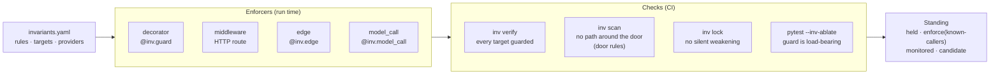

# invariants

**OpenAPI and pydantic define the shape of your APIs. Invariants define their laws, at every layer, so
coding agents can't break a law or go around an API.**

[](../.github/workflows/ci.yml)
[](pyproject.toml)
[](LICENSE)
[](CHANGELOG.md)

Every layer of a system is an API: the HTTP route, the service method, the repository method, the
model call, the payment client. `invariants` puts two kinds of law on those boundaries, in one
reviewed YAML file:

- **value laws:** on this API, these inputs or outputs are never allowed ("a refund never exceeds
  the charge"), from your pydantic limits or a `bad` condition on `args` and `result`;
- **path laws:** this lower API is called only through that upper one ("only `BillingService.refund`
  calls `RefundGateway.refund`"), whatever is behind the repository: SQLAlchemy, Django, MongoDB,
  DynamoDB, Stripe or raw SQL.

People own the laws at the boundaries; agents are free inside the implementations. A CLI check in CI
proves no change loosened a law and no call path skips a door. At run time, decorators check what a
model returns, what its consumer receives and what reaches a tool door: the part no CI check can see.
A pytest plugin proves each one is load-bearing by switching it off and watching a test fail.

## Start in 10 minutes: lock the laws you already have

You don't need to write a rule to start, and nothing changes in production: install it as a dev tool
and never import it. Your pydantic `Field(le=10_000)`s and `Literal`s are already value laws. Your
service layer is already a set of path laws: the endpoints call `ExpenseService.refund()`, and only it
calls the payment gateway. `inv init` finds both, freezes the back doors that skip a service today,
and from then on no change can loosen a limit or add a back door without a person accepting it.

```bash
pip install invariants-first        # a dev dependency; not on PyPI yet: pip install -e path/to/invariants-py
inv init                            # drafts invariants.yaml from your code and locks it; commit both files
```

```text
$ inv init
wrote invariants.yaml
  read 7 source file(s)
  pinned 2 pydantic model(s) with 7 constraint(s)
  suggested 2 rule(s) from function preconditions (commented out; see the file)
  door REFUND-GATEWAY-DOOR: quota.repo.RefundGateway through quota.service.ExpenseService.refund (1 caller(s))
    found 1 back door(s) in scripts/admin.py; frozen in allow, so check passes and a new one fails
  door EXPENSE-STORE-DOOR: quota.repo.ExpenseStore through quota.service.ExpenseService.approve (1 caller(s))
    found 1 back door(s) in scripts/admin.py; frozen in allow, so check passes and a new one fails
  door USAGE-REPO-DOOR: quota.repo.UsageRepo through quota.service.QuotaService.consume or quota.service.QuotaService.new_month (2 caller(s))
    found 1 back door(s) in quota/worker.py; frozen in allow, so check passes and a new one fails
running `inv lock` to pin them ...
wrote invariants.lock: 3 rule(s), 0 target(s), 0 provider(s), 2 contract(s), 2 schema(s)
next: commit invariants.yaml and invariants.lock, and run `inv check` in CI and pre-commit (the invariants docs: start.md, "Make the check unskippable")
```

An agent raises a limit to make its test pass, then re-pins the lock itself to hide the change.
CI compares against `main` and still catches it. This is real output:

```text
$ inv check --base main
inv check: invariants.yaml
  ok    rules: 3 rule(s), 2 contract(s) load
  ok    lock: invariants.lock matches
  FAIL  since main
        1 change(s) since main weaken a rule:
          schema quota.models.UsageEvent: pydantic.properties.units.maximum: 10000 -> 100000  WEAKENED (maximum raised: larger values pass; used by contract usage_event schema)
        a person must accept these: re-run with --accept-weakening or INV_ALLOW_WEAKENING=1, set by a reviewer (for example from a pull-request label), never by the change's author or agent
  ok    guards: verify: pass (0 targeted rule(s) guarded; no guard module was imported, so no guard was checked; to check one, name a guarded function as a rule's target or pass --import MODULE)
  ok    scan: no path skips a door or guard
fail
```

An agent's new script that calls the gateway directly fails the same check:

```text
  FAIL  scan
        bypass     REFUND-GATEWAY-DOOR scripts/refund_tool.py:5:5  scripts.refund_tool.refund_customer -> quota.repo.RefundGateway.refund reaches the sink without passing quota.service.ExpenseService.refund
        REFUND-GATEWAY-DOOR: fail (1 bypass)
        EXPENSE-STORE-DOOR: pass (no findings)
        USAGE-REPO-DOOR: pass (no findings)
        scanned 9 file(s), 22 function(s)
fail
```

To make the check hard to skip, copy one snippet per layer: a pre-commit hook (`inv check --relock --fail-on-repin`),
a GitHub Action (`inv check --base`, which a reviewer's label can override) and Claude Code hooks.
The `inv hook pretool` hook stops the agent from accepting a weakening, and `inv hook stop` keeps it
from finishing while the check fails. The agent hooks are an early warning; the CI check against the
base branch is the gate. [docs/start.md](docs/start.md) has all three snippets.

## Step 2: the model and its tools, at run time

Step 1 governs what people and coding agents write into the repository. It cannot govern what a
model outputs at run time on live input: a prompt-injected ticket, a graph-state reducer that changes
a plan after it was checked, a ledger that moved between plan and act. Step 2 puts the checks there:

- `@inv.model_call` parses the reply into a closed schema and retries a format failure with the
  parser's message; a reply that breaks a rule is resampled blind (the model never sees the rule),
  and never resampled when the rule judges it against your own records (`compares_to: held_data`);
  an abstention opens a review for a person instead of running anything;
- `@inv.edge` on the node that consumes the reply re-checks it against held state as it is now, so a
  forged, swapped or since-stale value is caught where it is used;
- `@inv.guard` on the tool doors the reply reaches (refund, credit, write) checks every caller;
- outcome errors never carry the values they read.

Instructor and PydanticAI already give you the shape: a pydantic model, a retry with the validation
error, your own validators. Keep using them inside the body if you like; this adds the reviewed and
locked rule, the blind or forbidden resample, abstention, the edge re-check and value-free errors.
See [concepts](docs/concepts.md#model-calls), [models.md](docs/models.md) and
[agent-frameworks.md](docs/agent-frameworks.md) (native tool use and LangGraph).

Guards on ordinary deterministic code (a CRUD handler, a service method a person wrote and tested)
are optional; a plain Python `if` is fine there. A guard is worth it on the few that move money,
where the lock, the scan's door and ablation are worth having around the check.

## Before and after

An agent adds a helper. It looks fine, and the tests it wrote pass:

```python
def refund_order(charge_id: str, total: int, refunded: int) -> None:   # an agent's new helper
    refund(charge_id, charged=total, refunded=refunded, amount=total)   # forgets the earlier refund
```

One rule, written once, next to the code it protects:

```yaml
  - id: PAY-1
    status: enforce
    statement: a refund is positive and never exceeds what is left of the charge
    subject: {target: "py:payments.refund"}
    bad:
      - {when: 'args.amount <= 0', message: refund must be positive}
      - {when: 'args.refunded + args.amount > args.charged', message: refund exceeds what is left of the charge}
    enforcers: [{point: decorator, timing: pre_effect, mode: enforce, on_violation: reject}]
    falsified_by: [test_payments.py::test_over_refund_is_rejected]
```

`status: enforce` needs the test that proves the rule: without `falsified_by`, `inv validate`
refuses it ("highest allowed: detect").

The money never leaves:

```text
invariants.errors.Rejected: PAY-1 violation: refund exceeds what is left of the charge
```

And CI proves the guard, not luck, is what stopped it:

```text
$ pytest --inv-rules invariants.yaml --inv-ablate -q
..                                                                       [100%]
----------------------------- invariants ablation ------------------------------
  PAY-1: load-bearing
      caught         test_payments.py::test_over_refund_is_rejected
2 passed in 0.06s
```

## Why invariants-first

Tests check the cases someone thought of. Types check shapes. The properties that matter most
usually live in scattered `if`s that a new caller, human or agent, can simply skip. This library
keeps each property as one reviewed record with an owner and a status, and then checks three
things nothing else checks together: that the guard runs, that it is the reason the bad case
fails, and that no code path goes around it.

| | invariants-first | plain `assert`/`if` | pydantic | icontract / deal | OPA / Cedar | hypothesis |
|---|---|---|---|---|---|---|
| Checks at run time | yes, at the call | yes | at the data boundary | yes (pre, post, class invariants) | yes, when the app asks | no (test time) |
| Rules reviewed apart from code, with owner and status | yes | no | no | no (in code) | **yes, and at scale** | no |
| Ablation-proven falsifier (`--inv-ablate`) | yes | no | no | no | policy unit tests, not proof the app calls them | no |
| Mediation scan: no path around the guard (`inv scan`) | yes | no | no | no | no | no |
| Weakening-gated lockfile (`inv lock`) | yes | no | no | no | git diff only | no |
| Model-call parse, retry, abstain, and checked edges | yes | no | **parsing yes**, the loop no | no | no | no |
| Standing report (held, monitored, candidate) | yes | no | no | no | no (decision logs record calls) | no |
| Finds inputs nobody thought of | no | no | no | deal: cases generated from contracts | Cedar: formal policy analysis | **yes** |
| Maturity and ecosystem | alpha, 0.1 | built in | **excellent** | mature | **production-grade** | **excellent** |

These tools fit together: invariants uses pydantic models as reply schemas, and a hypothesis test
makes a fine falsifier. Choose OPA or Cedar for authorization across services, icontract or deal for
rich class contracts, and invariants for evidence that a property holds on every path in one codebase.

## Is this for me?

We measured it, on a small scale: 24 seeded changes (16 defects, 8 benign) against the two example
apps, compared with the same properties written as plain `if` checks plus tests. One author wrote
both the changes and the rules, so read the method and the verdict in
[docs/evaluation.md](docs/evaluation.md) before quoting the numbers.

- **Caught:** 8 of 8 defects that a rule covered. 6 of the 16 defects were caught by an invariants
  mechanism (guard, scan, lock or load check). 4 of those would have escaped the same properties
  written as plain checks and tests: 2 door bypasses (scan), 1 rule weakening (lock, if someone
  reads the diff) and 1 broken binding (a load check, for a defect the library itself makes possible).
- **Not caught:** 0 of the 8 defects no rule covered (ordinary tests caught 3). It does not replace tests.
- **Cost:** about 240 to 270 rule lines per app and about 180 human decisions in all. After the contract-level lock,
  only 2 of the 24 changes failed `inv lock --check` (down from 18), and 1 of 8 benign changes
  needed a re-pin.

**The 10-minute path costs almost nothing.** Run against a copy of the pool-service example app,
`inv init` pinned its 7 pydantic models (13 constraints) and proposed one door rule for its store:
every write goes through 7 service functions. It listed 11 back doors: 7 real calls (a benchmark and
two endpoints that write the store directly) and the 4 bypasses planted in the app's
`bypass/pool_service/rogue.py` (2 direct sink calls, a door called without its guard, and a sink
reached through `getattr`; raw SQL is below the API and is not planted there). `allow` cannot freeze
the last two, so it wrote the door rule commented out, with the findings to review; `inv check`
passed with its scan step skipped, and a new direct write is caught only once the rule is turned
on. With the planted `bypass/` directory removed, it wrote the rule with the 7 real back doors
frozen in `allow`, `inv check` passed straight away, and a new direct write failed it. On an app built on SQLAlchemy, a Django-style
manager and Stripe, with no SQL, it found the three repositories, their service doors and the 3 back
doors in a worker and an admin script. On the tool-calling [support agent](../apps/support-agent),
it found the 4 tool and plan schemas, both repository door rules with the 3 tools as callers, and the
one real back door (a legacy admin refund), and all 12 defects seeded there are caught. It costs no
rule lines and no decisions beyond reading the drafted file. It catches loosened limits and new back
doors, not new bugs.

**The full system pays off** when you have a few high-stakes properties (money, quotas, approvals, provenance),
when agent-written code adds new paths without tests, and when reviewers really read rule and lock
diffs. **It does not** when most defects are business logic no rule states, when the rule set churns
faster than it is reviewed, or when the property depends on a provider that is itself the bug.

## How it fits together



## Quickstart

This is the full system, end to end on one rule. For the lighter start, see
[Start in 10 minutes](#start-in-10-minutes-lock-the-laws-you-already-have).

```bash
pip install 'invariants-first[schema]' pytest   # not on PyPI yet: pip install -e 'path/to/invariants-py[schema]'
```

Python 3.11+; the core depends only on PyYAML. Extras: `[schema]` (the JSON Schema check in
`inv validate`), `[cel]` (the cel-expr CEL engine, Google's C++ runtime), `[pydantic]`, `[fastapi]` (with httpx, for
`fastapi.testclient`), `[otel]`, `[anthropic]` (`integrations.anthropic`) and `[dev]` (the test and
type-check tools, for contributors). The distribution name is a placeholder ([RELEASING.md](RELEASING.md#before-publishing));
you always `import invariants`.

**1. The rule file**, `invariants.yaml`:

```yaml
spec: invariant/v0.1
targets:
  "py:payments.refund": {effects: external}
rules:
  - id: PAY-1
    status: enforce
    owner: payments
    statement: a refund is positive and never exceeds what is left of the charge
    subject: {target: "py:payments.refund"}
    bad:
      - {when: 'args.amount <= 0', message: refund must be positive}
      - {when: 'args.refunded + args.amount > args.charged', message: refund exceeds what is left of the charge}
    enforcers:
      - {point: decorator, timing: pre_effect, mode: enforce, on_violation: reject}
    mediation:
      chokepoint: money leaves only through payments.refund
      sink: "py:payments.send_to_gateway"
    falsified_by: [test_payments.py::test_over_refund_is_rejected]
```

**2. The code**, `payments.py` (in the app, call
`inv.load(pathlib.Path(__file__).parent / "invariants.yaml")` once at startup; in tests,
`--inv-rules` loads it):

```python
import invariants as inv


def send_to_gateway(charge_id: str, amount: int) -> None:   # the effect: money leaves
    print(f"refunded {amount} on {charge_id}")


@inv.guard("PAY-1")
def refund(charge_id: str, charged: int, refunded: int, amount: int) -> None:
    send_to_gateway(charge_id, amount)
```

**3. The falsifier**, `test_payments.py`:

```python
import pytest
import invariants as inv
from payments import refund


def test_partial_refund_is_allowed():
    refund("ch_1", charged=5000, refunded=1500, amount=3500)


def test_over_refund_is_rejected():
    with pytest.raises(inv.Rejected):
        refund("ch_1", charged=5000, refunded=1500, amount=5000)
```

**4. Check it.** This is real output:

```text
$ inv validate
ok: invariants.yaml: 1 rule(s) PAY-1
$ inv lock --lock invariants.lock
wrote invariants.lock: 1 rule(s), 1 target(s), 0 provider(s), 0 contract(s), 0 schema(s)
$ inv scan
PAY-1: pass (no findings)
scanned 1 file(s), 2 function(s)
$ inv status --import payments
PAY-1 (enforce: blocks a bad call; held (unproven: no --ablation))
  checks:  py:payments.refund refuses a call when: refund must be positive; refund exceeds what is left of the charge; and every call to py:payments.send_to_gateway goes through py:payments.refund
  guard:   yes
  scan:    pass, no path skips it
  ablation proved it: not run
  next:    prove its tests fail without it: pytest --inv-rules invariants.yaml --inv-ablate --inv-report-json build/inv-report.json, then inv status --ablation build/inv-report.json
verify: pass
$ pytest --inv-rules invariants.yaml --inv-ablate --inv-report-json build/inv-report.json -q
..                                                                       [100%]
----------------------------- invariants ablation ------------------------------
  PAY-1: load-bearing
      caught         test_payments.py::test_over_refund_is_rejected
invariants report written to build/inv-report.json
2 passed in 0.24s
$ inv status --import payments --ablation build/inv-report.json
PAY-1 (enforce: blocks a bad call; held)
  checks:  py:payments.refund refuses a call when: refund must be positive; refund exceeds what is left of the charge; and every call to py:payments.send_to_gateway goes through py:payments.refund
  guard:   yes
  scan:    pass, no path skips it
  ablation proved it: yes
verify: pass
```

The scan counts `payments.py` only: test files (`test_*.py`, `tests/`, `conftest.py`) are skipped
by default. `inv status` drops "unproven" from `held` once the ablation report shows the rule's
test failing with the rule switched off.

**5. Now break it.** Add `ops.py`, a "quick fix" that pays out around the guard:

```python
from payments import send_to_gateway


def goodwill_credit(charge_id: str) -> None:      # an agent's "quick fix"
    send_to_gateway(charge_id, 2500)
```

```text
$ inv scan
bypass     PAY-1    ops.py:5:5  ops.goodwill_credit -> payments.send_to_gateway reaches the sink without passing payments.refund
PAY-1: fail (1 bypass)
scanned 2 file(s), 3 function(s)
```

Or quietly relax the rule, `args.amount <= 0` to `args.amount < 0`, and re-pin:

```text
$ inv lock --lock invariants.lock
invariants.lock: 1 change(s) against the stored lock
  rule PAY-1: bad [refund must be positive]: 'args.amount <= 0' -> 'args.amount < 0'  WEAKENED (the condition now matches fewer cases)
refused: 1 change(s) weaken a rule; the lock was not written. Review them and re-run `inv lock --accept-weakening` to accept them.
```

Both exit 1, so CI goes red. More patterns are in the [cookbook](docs/cookbook.md).

## Core concepts

- **Rule.** An `id`, a human-set `status`, and a CEL expression `bad` that is true when the property
  is broken. A rule says what must not happen, never what to do instead.
- **Target and effects.** The `py:` function a rule guards, with its effects declared once:
  `none` (a pure function: a post-effect check can stop the result) or `external` (only pre-effect
  checks can stop it; a post-effect check reports).
- **Enforcers.** Where the rule runs: `decorator`, `middleware`, `model_call`, `edge`, `monitor`,
  `structure` (the scan), or outside the process (`type`, `gateway`, `build`). Each has a `timing`, a `mode` (`off`, `detect`, `enforce`)
  and an `on_violation` (`reject`, `halt`, `escalate`, `route`).
- **Four outcomes.** `ok`, `violation`, `rule_error` (the rule could not be evaluated) and
  `parse_error` (a model reply). A rule error is never a violation, and `on_error` decides it.
- **Providers.** Typed, read-only functions that give a rule data the call does not carry (an
  order, an approval), read at the enforcer's timing. A check on an API's arguments is not a lock:
  two concurrent callers can both pass, and what the store does about that is its own business.
- **Standing.** Computed, not claimed: `held` only when the rule is enforced, its chokepoint names
  one of the rule's functions, no residual path is listed and no live `allow` back door is left
  undeclared, `inv verify` and `inv scan` pass, and a falsifier was caught under ablation (without
  `--ablation`, `inv status` says `held (unproven: no --ablation)`).
- **Nothing below the API.** Rules name APIs only. What happens below the lowest API (SQL,
  triggers, transactions, isolation levels) is the implementation's business.

All of it, including `old_self` transition rules, model calls and edges, is explained in
[docs/concepts.md](docs/concepts.md).

## Integrations

- **pytest.** The plugin is installed with the package. `--inv-rules`, `--inv-verify`,
  `--inv-ablate` (with `--inv-ablate-lenient`), `--inv-report` and `--inv-report-json` (both count
  `abstain` beside the other four outcomes), and the fixtures `inv_registry`, `inv_ablated`,
  `inv_events` and `inv_scan`.
- **FastAPI.** `@inv_fastapi.guard` under the route decorator binds rules to the parsed parameters,
  and `inv_fastapi.install(app)` maps outcomes to `application/problem+json`: 422 reject, 202
  route or escalate, 500 halt, 503 fail-closed rule error. Bodies never echo
  values. A `Response` the handler returns itself (`JSONResponse(..., status_code=404)`) is sent as
  it is. `InvariantMiddleware` does the same for any ASGI app.
- **Pydantic.** A model with `extra="forbid"` is a closed reply schema, validated strictly, and a
  contract type that `inv lock` pins by its JSON schema.
- **OpenTelemetry.** `inv.configure(exporter=otel.exporter())` emits one span per evaluation.

Details: [docs/api.md](docs/api.md#integrations).

## CLI

| Command | What it does |
|---|---|
| `inv init [--root DIR] [--exclude GLOB] [--no-lock] [--graphify GRAPH] [--max-doors N]` | Drafts `invariants.yaml` from the laws the code already has (pydantic constraints, service-to-repository doors, function preconditions with module constants), then locks it. Reads a [Graphify](https://github.com/Graphify-Labs/graphify) `graphify-out/graph.json` when there is one, for doors its naming heuristics miss; the scan still checks each. [More](docs/start.md) |
| `inv check [--relock [--fail-on-repin]] [--base REF [--accept-weakening]]` | `validate`, `lock --check`, `verify` and `scan` with one exit code. `--relock` re-pins when nothing weakens (`--fail-on-repin` then exits 1 so the new lock is staged); `--base` also fails on a weakening since REF unless a reviewer passes `--accept-weakening` (or sets `INV_ALLOW_WEAKENING=1`), and fails closed when REF or its lock cannot be compared. Accepted `allow_unresolved` sites are listed under the scan line. |
| `inv hook [rulefile] pretool\|stop` | Claude Code hooks: block accepting a weakening, a direct edit of `invariants.lock` or of `[tool.invariants]`, a command that rewrites either without naming it (a script or pytest conftest whose text names it, `git apply`, `patch`, `git checkout REF -- .`, `git merge`/`switch` to a commit that changes it) and an edit of `.claude/settings.json`; refuse to finish while `inv check` fails. [More](docs/start.md#4-make-the-check-unskippable-5-minutes) |
| `inv validate` | JSON Schema plus every load-time check (targets, providers, types, functions per CEL backend). |
| `inv lock [--check] [--accept-weakening]` | Pins what each rule's meaning depends on; refuses a weakening unless accepted. [More](docs/lockfile.md) |
| `inv verify --import MOD` | Every target carries its guard, and every guard names a rule. |
| `inv scan [--format text\|json\|sarif]` | No call path reaches a sink around its door (an allowed back door is not a door: a new caller of one fails); flags `getattr`, `__wrapped__` and monkeypatching. [More](docs/scan.md) |
| `inv status --import MOD [--ablation JSON]` | Per rule, in plain words: what it checks, whether a guard wraps it, the scan result, whether ablation proved it, and what to do next. `--ablation` reads the pytest `--inv-report-json` file; without it a `held` rule is labelled unproven. `--json` keeps the `standing` and `reasons` fields. |
| `inv mcp`, `inv-mcp [--root DIR]` | A read-only MCP server (stdio) for coding agents: `scan`, `check`, `status`, `explain` and `propose_rules`. It never writes the rule file, the lock or `allow`. [More](docs/agents.md) |

Every command but `scan` and `mcp` takes `--path DIR` (repeatable) to import your app from DIR too;
your project's `src/`, its setuptools `where` directories and scan roots, the rule file's directory
and the project root are on the import path already, ahead of site-packages
([more](docs/lockfile.md)). `inv --version` prints the version.

Exit codes: 0 ok, 1 a check failed, 2 usage error, 3 the scan has unresolved calls (not a pass),
4 the scan skipped an ablated `enforce` rule (not a pass).

## Performance

Guard overhead per call: one `pre_effect` decorator enforcer, no providers, Apple M4 Max, Python
3.14. The 4-clause rule includes an `exists` over an 8-element list.

| Backend | 1 clause p50 | 1 clause p99 | 4 clauses p50 | 4 clauses p99 |
|---|---|---|---|---|
| `subset` (default, stdlib) | 7.1 µs | 8.4 µs | 22.7 µs | 28.3 µs |
| `cel-expr` (CEL C++) | 9.6 µs | 10.7 µs | 22.0 µs | 27.9 µs |

Use `subset` or `cel-expr` on hot paths. At HTTP scale the overhead is noise. Providers add their own
cost on every call. The method and the per-operation costs are in [docs/cel.md](docs/cel.md#performance).

## Limitations

- **Coverage is only as good as the rules.** In the evaluation, no defect outside a rule was caught.
- **The scan is approximate.** It types a method call's receiver only when it is sure (a constructor,
  an annotated parameter, a factory annotated `-> Repo`, `self.x` set in `__init__`, an attribute chain such as `ctx.billing` on a
  typed `ctx`, never an attribute some code sets from outside); it does not follow dependency injection
  containers, event buses or callbacks, and it cannot see callers outside the scanned roots. An
  unresolved call is reported as unresolved, never as a pass. [docs/scan.md](docs/scan.md#limitations)
- **Door discovery is a heuristic.** It finds repositories by name (Repo, Store, Gateway, DAO, `repo`,
  `store`, `db` modules) and by the writes in their bodies, and prefers service-layer callers as
  doors; a Graphify graph adds doors between communities. Review what `inv init` proposes;
  [docs/start.md](docs/start.md#limits) has the details.
- **`inv.Checked` is forgeable** (Python cannot prevent it), so every `@inv.edge` re-validates the
  schema and re-checks `bad` on what it receives.
- **CEL subset.** Rule text must stay within the common grammar (`b"..."` is a parse error, and an
  unsigned literal such as `1u` loads only on cel-expr). Some functions exist only on some backends, and a few cases differ between engines.
  The load-time type checker is conservative. NaN and Infinity are `rule_error`s by default.
  [docs/cel.md](docs/cel.md)
- **The lockfile's weakening analysis is syntactic.** Anything it cannot decide counts as a possible
  weakening, never as safe. A behaviour change inside a function body does not change the lock.
  [docs/lockfile.md](docs/lockfile.md#limitations)
- **Ablation.** A falsifier that runs `inv scan` must assert the rule's findings, not a non-zero
  exit: while its rule is ablated the scan exits 4, which is neither a pass nor a fail (the
  `inv_scan` fixture enforces that). Ablating a rule held only by a closed schema (`point: type`)
  does not relax parsing, so it reports not load-bearing. A falsifier counts as caught only if its
  rule fired (rejected, escalated) on the control run; one that merely calls the guarded code is
  inconclusive. `INV_ABLATE` with `INV_ABLATE_TESTING=1`
  turns guards off, so never set both in production. [docs/concepts.md](docs/concepts.md#ablation)
- **Providers run per call**: every provider bound to a name a clause reads is called on every call
  (there is no data-dependent short circuit). Pydantic
  replies must carry every field, and are strict by default. HTTP rules bind to handler parameter
  names, not OpenAPI paths.
- **Not in v0.1:** clauses scoped to one enforcer, rules that reference contract enums, a sampled mode,
  and conformance cases beyond CEL.

## Documentation

| | |
|---|---|
| [Start in 10 minutes](docs/start.md) | `inv init`, the short rule form, pre-commit, CI and agent hooks |
| [Concepts](docs/concepts.md) | outcomes, standing, status and mode, providers, targets and effects, model calls, edges, `old_self`, operations |
| [Rule file reference](docs/rule-file.md) | every field |
| [CEL](docs/cel.md) | backends, the Python-to-CEL type mapping, NaN policy, numbers, time zones, cost limits |
| [Lockfile](docs/lockfile.md) | the v3 format, field policy and weakening |
| [Scan](docs/scan.md) | door rules, allow, receiver typing, reachability |
| [API](docs/api.md) | every public name, the pytest plugin and the integrations |
| [Cookbook](docs/cookbook.md) | 10 runnable recipes |
| [Agents](docs/agents.md) | the agentic flow (understand, propose, verify, approve, lock) and the `inv mcp` / `inv-mcp` server |
| [Models](docs/models.md) | `integrations.anthropic`: Claude in a model-call body, trace replay and recording |
| [Evaluation](docs/evaluation.md) | the measured experiment and its verdict; the harness is in [evaluation/](evaluation) |
| [Invariant-first](docs/design-guide.md) | the whole system for engineers: the two kinds of law, how each is checked, the architecture, a worked agent example, the limits |

**Examples.** [apps/support-agent](../apps/support-agent) is a tool-calling support agent (a
planner model call, an executor edge, billing doors) with 12 seeded agent defects, each caught;
[apps/pool-service](../apps/pool-service) is a FastAPI and SQLite lease service with an LLM triage
step; and [apps/fact-pipeline](../apps/fact-pipeline) is a batch pipeline that extracts cited facts
with a model. Each app's model runs on a deterministic fake by default; `APP_MODEL` picks a replayed
trace (the committed traces are hand-written), Claude, or a recording
([docs/models.md](docs/models.md)). Each is a standalone project whose `ci.sh` runs every check.

## Contributing

`pip install -e '.[dev,cel]'`, then run the suite on each CEL backend
(`INV_CEL_BACKEND=subset|cel-expr python -m pytest tests -q`) and `python -m mypy`. The library
never rewrites your code's AST and never calls `eval` or `exec` (a test checks its source for
`eval(` and `exec(`).
See [CONTRIBUTING.md](CONTRIBUTING.md), [SECURITY.md](SECURITY.md) and [RELEASING.md](RELEASING.md).
Licensed under [Apache-2.0](LICENSE).
